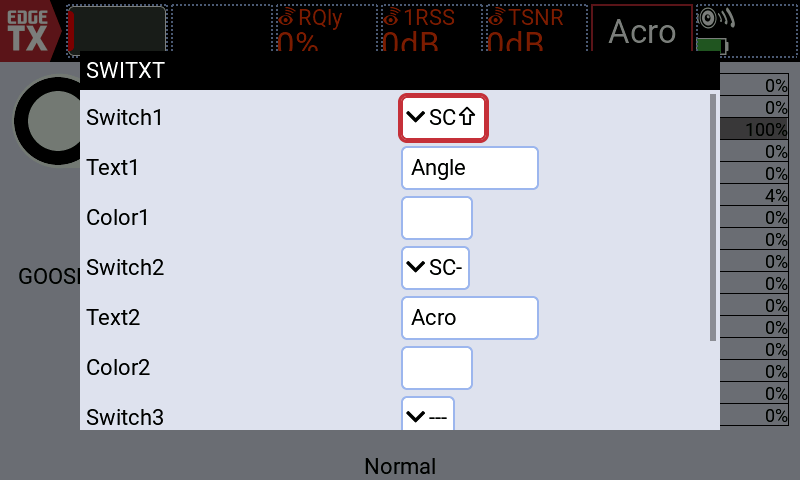
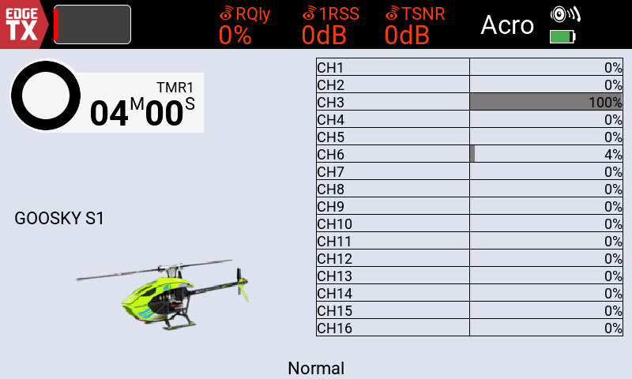
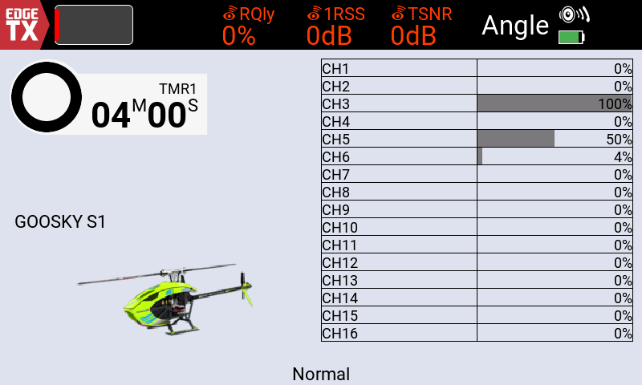
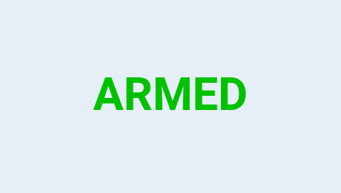

# SWITXT
### Switch positions. Clear status.

Custom switch-status text for color and monochrome EdgeTX radios.

**Three assignments · Automatic text sizing · Custom colors on color radios**

[Download v1.3.0](https://github.com/Pencilvestr/SWITXT/releases/download/v1.3.0/SWITXT.zip) · [Setup guide](docs/setup.md) · [Report an issue](https://github.com/Pencilvestr/SWITXT/issues)

## Screenshots

### TX16S MK3

  

<table>
  <tr>
    <td width="50%"></td>
    <td width="50%"></td>
  </tr>
</table>

### Simulator screenshots

| Color · TX16S | Monochrome · Boxer |
| :---: | :---: |
|  |  |

| Monochrome · Pocket | Monochrome · X9D+ 2019 |
| :---: | :---: |
|  |  |

Actual EdgeTX 2.12.5 simulator captures with synthetic model settings. [Full gallery](docs/native-screenshots.md).

## Install

Download and extract **SWITXT.zip**, then copy the folder for your screen type to the SD card:

| Screen | Copy | Select on the radio |
| :--- | :--- | :--- |
| Color | `WIDGETS/SWITXT` | **SWITXT** in Widget settings |
| Monochrome | `SCRIPTS/TELEMETRY/switxt.lua` | **switxt** as a Script telemetry screen |

Restart the radio after copying.

## Configure

**Color:** set each assignment's switch position, text, and color in Widget settings.

**Monochrome:** configure **L01**, **L02**, and **L03** for your model. Their default labels are **ARMED**, **DISARMED**, and **MOTOR OFF**. Edit the `assignments` table near the top of `switxt.lua` to change labels or switch names.

Assignments have priority **1 → 2 → 3**. Only the first active label appears; none active means blank. Text shrinks to fit, then uses `...` if needed.

[Detailed setup and troubleshooting](docs/setup.md).

## Compatibility

Targets **EdgeTX 2.11+ with Lua enabled**. Color radios use a widget; 128×64 and 212×64 monochrome radios use a telemetry script.

**Eight native simulator targets pass on EdgeTX 2.12.5.** Physical-radio testing remains pending. [Tested targets and limitations](docs/compatibility.md).
