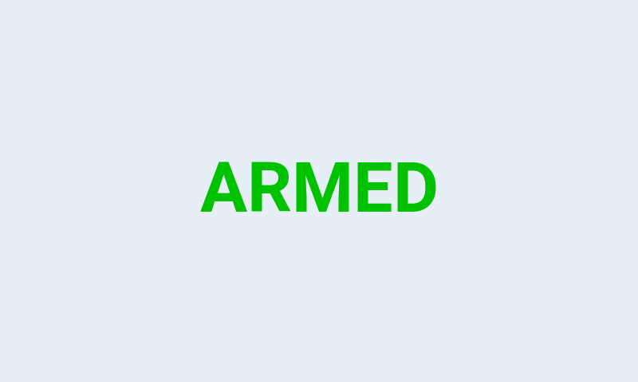
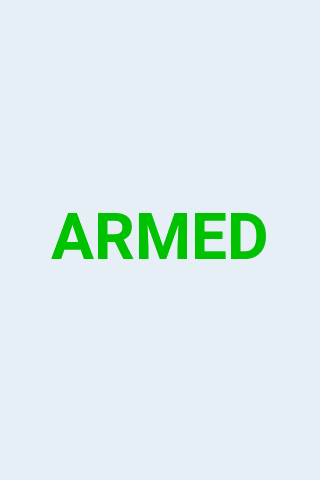
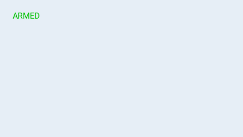

# Native simulator screenshots

These are direct LCD-framebuffer captures from the official, fingerprint-pinned
EdgeTX **2.12.5** simulator. They show SWITXT 1.3 with synthetic model settings
and native logical-switch conditions. The production Lua files were copied
unchanged. These are firmware renders, not mockups or physical-radio photographs.

Capture and source hashes are recorded in [native-verification.json](native-verification.json).
See [compatibility](compatibility.md) and the [native test guide](../tests/native/README.md).

## Color radios

| TX16S MK3 · 800×480 | TX16S · 480×272 |
| :--- | :--- |
|  |  |

| TX15 · 480×320 | PA01 · 320×240 |
| :--- | :--- |
|  |  |

### NV14 · 320×480 portrait

## Monochrome radios

| Boxer · 128×64 | Pocket · 128×64 | X9D+ 2019 · 212×64 |
| :--- | :--- | :--- |
|  |  |  |

## Small-area fitting

The observer supplies an 80×40 area near the upper-left corner to the unchanged
color renderer. The remaining display area is intentionally blank.

| Short label | Long label, visibly shortened |
| :--- | :--- |
|  |  |

The automated suite also checks that inactive labels leave blank pixels,
configured colors render correctly, and full-screen entry and return use real
native event values. Physical-radio validation is still pending.
